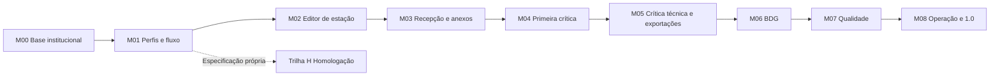

# TODO e milestones — evolução incremental do SADGEO

Plano para evoluir a base 0.2, apoiado nos cinco documentos recebidos e nos cinco estágios do processo. Os incrementos abaixo são propostas de entrega; não há datas ou estimativas prometidas. Escolher um marco de cada vez, com demonstração e aceite da área usuária.

Referências: [telas e menus](docs/TELAS-E-MENUS.md), [rastreabilidade e decisões](docs/RASTREABILIDADE.md), [cadastros/testes](docs/CADASTROS-E-TESTES.md) e [execução](README.md).

## Entregue na 0.2 (preservando a base 0.1)

- [x] React/Material UI integrado ao Spring Boot no mesmo JAR; substituição do dashboard Vaadin.
- [x] Login demonstrativo, sessão/CSRF e configuração Oracle/LDAPS por ENVVAR.
- [x] Menu hierárquico, rodapé com build/profile/hostname e conta/login/logout no cabeçalho à direita.
- [x] Painel de Controle como tela padrão autenticada.
- [x] Crítica de Dados e sete análises com template de **consulta**, filtros e paginação no servidor.
- [x] Filtros implícitos `medA`, `medG`, `medP`, `vrf`, `veg`, `ogr`, `gab` aplicados pela API.
- [x] CRUD de Campanha e dez tabelas básicas, incluindo Localização e Pendências; descoberta de PK Oracle e allowlist de manutenção.
- [x] Scripts curl/PowerShell com sessão, CSRF, filtros e CRUD demonstrativo com limpeza.
- [x] Testes Java/React, JDBC em H2 modo Oracle e navegação em navegador desktop/móvel.
- [ ] Validar Oracle e AD/LDAPS institucionais; fixtures/H2 não substituem esse aceite.
- [ ] Informar tabelas/campos/chaves de NUE, Códigos de Estação e Tipo de Ocorrências.

- [x] Gerar novas telas de recepção/SIGCVEG, rascunho, acompanhamento, documentos, filas BDG, qualidade, auditoria, modelos e ajuda.
- [x] Detalhe do registro com abas Dados Gerais, Coordenadas, Fotos, Documentos, Pendências e Histórico; comandos do processo desabilitados.
- [x] Prévia local de rascunho/modelo/clonagem e arquivos/imagens, sem upload ou gravação de estação.
- [x] Análise de produção com filtros e exportação CSV da consulta/página/registro; formatos oficiais continuam pendentes.
- [x] Tela de estado de integrações usando configuração e health reais, distinguindo configuração de conectividade.

Importação definitiva, imagens vinculadas, homologação e administração têm **telas geradas**, sem execução do processo. A crítica operacional, o salvamento de estação, histórico persistente, mapa conectado, exportações oficiais e carga BDG são mudanças de impacto e permanecem nos marcos abaixo. Não confundir CRUD de códigos básicos com esses casos de uso.

## M00 — Consolidar 0.2 no ambiente institucional

**Objetivo:** estabelecer uma base real e reproduzível antes das novas operações de produção. Responsáveis sugeridos: desenvolvimento, DBA/infraestrutura e representante usuário.

- [ ] Validar conexão, permissões, PKs e mapeamentos com Oracle real, incluindo `GEOM` e as views do painel.
- [ ] Confirmar que `DIM_CAMPANHA` retorna os códigos esperados e conferir contagens com o ASP.
- [ ] Validar LDAPS, cadeia de certificados, DNS, sessão e logout com usuários institucionais.
- [ ] Executar scripts externos em modo consulta no ambiente real; testar gravações apenas em base de homologação com dados de teste definidos.
- [ ] Conferir charset/limites BYTE, datas, precisão numérica e campos de chave; catalogar defaults e sequences existentes, sem criá-los por suposição.
- [ ] Registrar resultado, versão de build e limitações aceitas; incluir walkthrough com usuários da equipe.

**Aceite:** usuários autorizados entram, as consultas batem com uma amostra do legado, usuário sem manutenção recebe 403 e a base de produção não é alterada pelos scripts de smoke.

## M01 — Alteração de impacto: domínio do fluxo, perfis e auditoria

**Pré-requisito:** M00. Fontes: ReqF03/04/09, ReqNF01, UC01/03/10/16/17/18. Responsáveis sugeridos: área de negócio e backend, com revisão do sênior Java.

- [ ] Resolver D01/D02: duas ou três instâncias e separação entre autor, primeiro crítico e crítico anterior.
- [ ] Inventariar tabelas, colunas e códigos de estágio, liberação/retenção, unidade, tema e histórico existentes.
- [ ] Definir matriz de permissão por ação × unidade × tema × estágio; modelar os papéis institucionais sem criar outra senha local.
- [ ] Implementar cadastro/vínculo de usuário, perfil e permissionamento solicitado no menu, conforme modelo confirmado.
- [ ] Implementar histórico de alterações e transições, com responsável, data/hora, motivo, valores anteriores e posteriores.
- [ ] Definir expiração de sessão (não superior a 2h de inatividade segundo UC17) e troca de contexto sem carregar seleção/permissões antigas.
- [ ] Impedir alteração concorrente silenciosa: versão do registro e resposta de conflito para revisão pelo usuário.

**Aceite:** testes de API provam que esconder/desabilitar botão não é a única proteção; autor/crítico inelegível é bloqueado, um registro de outra unidade/tema não é alterado indevidamente e toda transição deixa trilha. Os estados conceituais são mapeados a códigos reais antes de gravar Oracle.

## M02 — Alteração de impacto: área de trabalho e editor da estação

**Pré-requisitos:** M00/M01. Estágio 2; ReqF01/05/08/10, UC02/04/07/16.

- [ ] Evoluir o template de consulta para lista + detalhe por abas, preservando página, filtros e seleção.
- [ ] Criar API própria de estação/registro e DTOs de edição; não gravar a partir da view de fatos do painel.
- [ ] Implementar Dados Gerais, Localização, Coordenadas, vínculos de projeto/campanha/instituição/unidade/NUE e validações de campos.
- [ ] Consultar BDG para sugerir dados existentes, com origem/data visíveis e sem substituir alterações locais silenciosamente.
- [ ] Implementar modelos de descrição por monumento com prévia; confirmar a tabela/regras dos modelos.
- [ ] Implementar mapa e comparação BDG × SADGEO, verificando datum/SRID, fonte, data e unidade antes de mostrar diferenças.
- [ ] Acrescentar filtros cumulativos por UF/município, unidade, status, pendência, tema e intervalo, com contagem na mesma consulta autorizada.
- [ ] Definir política de exclusão de registro e dependências; implementar confirmação/histórico quando houver permissão de estágio.

**Aceite:** um registro de teste pode ser criado, editado, reaberto e comparado com a fonte; dados inválidos e edição fora do escopo são rejeitados. Em celular, o detalhe é utilizável sem comprimir a grade inteira.

## M03 — Alteração de impacto: recepção, fotos e documentos

**Pré-requisito:** M02; contratos de integração e armazenamento aprovados. Estágio 2; ReqF01/07/11, UC06/08/12/13.

- [ ] Implementar Recepção de Lotes: seleção de origem → prévia → erros/duplicidades → confirmação → relatório.
- [ ] Confirmar e implementar contrato SIDGEO, projeto/campanha/informante de origem e regras legadas (incluindo o significado de `status_vrf=1`).
- [ ] Especificar o recebimento SIGCVEG/DMC previsto em ReqF01, sem reconstruir o coletor externo.
- [ ] Associar registro, arquivo de origem e responsável; evitar duplicação em reenvios e informar rejeição por linha.
- [ ] Implementar galeria, upload/substituição e validação de fotos: panorâmica, chapa, BDG e situação para VEG.
- [ ] Listar e abrir fichas/cadernetas no GEDLivre; separar eventual gravação (UC13) da consulta até resolver D04.
- [ ] Registrar substituições e metadados de arquivo; definir política de armazenamento/retenção e falhas parciais.

**Aceite:** importar lote válido, inválido e repetido tem resultado previsível; a prévia não grava; anexos não podem ser associados ou visualizados fora do registro autorizado. O reenvio não duplica estações.

## M04 — Alteração de impacto: primeira crítica e acompanhamento

**Pré-requisitos:** M01–M03. Estágio 3.1; ReqF02/04/09, UC03/16.

- [ ] Criar caixa de trabalho GGC/GLGC/UE e atribuição de responsáveis conforme matriz validada.
- [ ] Implementar salvar rascunho, validar completude, registrar pendência e liberar para a segunda instância.
- [ ] Diferenciar salvar de liberar; explicar bloqueios e permitir correção com trilha.
- [ ] Implementar pedido de complemento mantendo estágio, conforme UC03, com aviso interno ao responsável.
- [ ] Implementar Acompanhamento da unidade, com estados/legendas além de cores e visualização do que já passou da 1ª crítica.
- [ ] Bloquear inserir, excluir, salvar e liberar no contexto de acompanhamento, inclusive por chamada direta à API.

**Aceite:** demonstrar um registro do rascunho à liberação, uma liberação bloqueada e um pedido de complemento. Nenhuma transição é executada duas vezes nem pode ser autoaprovada por pessoa inelegível.

## M05 — Alteração de impacto: crítica técnica, devoluções e exportações

**Pré-requisito:** M04. Estágio 3.2 e parte de 4.2; ReqF02/04/06/09/13/14, UC03/05/15/18/19.

- [ ] Aplicar o mesmo editor/fluxo na segunda crítica por tema, com regras técnicas e coordenação PROJ.
- [ ] Implementar reter, devolver com motivo e liberar para carga, sem alterar flags diretamente como toggles do ASP.
- [ ] Definir elegibilidade e retorno de estágio, incluindo complementação sem transição e histórico das decisões.
- [ ] Implementar clonagem por PROJ com prévia, origem/destino e lista de campos copiáveis; não copiar IDs, autoria de crítica, liberações ou histórico como se fossem novos.
- [ ] Garantir que leitura de outros temas não habilite edição irrestrita; validar permissões de origem e destino na clonagem.
- [ ] Implementar TXT, KMZ, relatório simplificado e layout Altimetria/CoordDalti com amostras de referência aprovadas.
- [ ] Acrescentar análise de produção por período, tema, unidade e etapa; contagens e exportações usam o mesmo escopo.

**Aceite:** devolver um registro retorna ao destino correto com justificativa; aprovar o torna elegível à carga, sem publicá-lo. Exportações não vazam registros fora do filtro/permissão e os formatos conferem com exemplos validados.

## M06 — Alteração de impacto: fila e reconciliação com BDG

**Pré-requisito:** M05 e contrato de carga BDG. Estágio 4.1/4.2; UC03/16 e processo E.

- [ ] Confirmar API/procedure/processo institucional, campos obrigatórios e forma de confirmação de carga.
- [ ] Implementar lista de elegíveis, envio em lote, protocolo, resultado por registro e tratamento de rejeições.
- [ ] Reenvio e retomada após falha não podem duplicar atualização; manter identificador estável da operação.
- [ ] Registrar tentativas e distinguir elegível, enviado, rejeitado e atualizado confirmado.
- [ ] Implementar reconciliação SADGEO × BDG e caminho de correção com nova validação quando aplicável.
- [ ] Confirmar regras de disponibilização externa; encaminhar a publicação ao canal institucional apropriado.

**Aceite:** testes de integração com retorno aceito, rejeitado, timeout, repetição e recuperação confirmam que “enviado” não vira “atualizado” sem confirmação. Corrigir dados não apaga o histórico do envio anterior.

## Trilha H — Homologação, após especificação própria

**Dependência:** decisões de M01 e dono do processo. As telas de menu existem como templates; não há UC suficiente para implementar a regra com segurança.

- [ ] Definir objeto da solicitação, atores, estados, anexos, critérios, processamento, aceite/rejeição e reabertura.
- [ ] Relacionar solicitação, estação, registros e versão de dados; confirmar vínculo com M06, sem presumir equivalência.
- [ ] Implementar Cadastro da Solicitação, Registro de Processamento e Realizar Homologação com autorização e trilha.
- [ ] Demonstrar solicitação aprovada, recusada e reprocessada, sem aprovar dados diferentes dos revisados.

**Aceite:** a área usuária aprova um caso de uso específico e a relação com crítica/carga é testada. Não usar esse item para bloquear os outros incrementos sem decisão explícita de negócio.

## M07 — Alteração de impacto: qualidade pós-produção

**Pré-requisito:** M06 e fontes de dados autorizadas. Estágio 5.1; ReqF12, UC09/19.

- [ ] Definir regras verificáveis: município/UF × geolocalização, imagens rotuladas, completude e coerência cadastral.
- [ ] Implementar execuções programadas, resultados por regra e identificação da versão/dados analisados.
- [ ] Criar fila de ocorrências com evidência, severidade, responsável, prazo pactuado e histórico de tratamento.
- [ ] Permitir executar novamente e comparar resultados; evitar duplicar a mesma ocorrência aberta.
- [ ] Disponibilizar relatórios de produção e qualidade; definir notificações internas pertinentes.
- [ ] Manter correção de dados como ação autorizada e revisável, sem ajustar automaticamente o BDG por uma heurística.

**Aceite:** uma inconsistência conhecida é detectada, atribuída, tratada e reavaliada; outra execução sem mudança não cria duplicatas. O relatório identifica fonte, regra, versão e data de execução.

## M08 — Operação e preparação de 1.0: operação e capacitação

**Pré-requisitos:** funcionalidades selecionadas aceitas e responsáveis de operação. Estágio 5.2; ReqNF01–05.

- [ ] Medir volume/concorrência representativos; combinar metas de resposta e limites de exportação antes de declarar desempenho suficiente.
- [ ] Corrigir gargalos do painel/cubo e evitar carregar coleções inteiras em endpoints usados em produção.
- [ ] Definir disponibilidade, recuperação, backup/restauração, monitoração e janelas de manutenção.
- [ ] Se houver múltiplas réplicas, testar sessão compartilhada/afinidade e coordenação de tarefas; não supor que sessão em memória sobreviva à troca de pod.
- [ ] Validar acessibilidade, navegadores suportados e fluxos de uso com cadastrador, crítico e gestor.
- [ ] Preparar manuais, dados de treinamento, runbook e registro de limitações conhecidas.
- [ ] Executar reconciliação e plano de transição do ASP, com retorno operacional definido antes do corte.
- [ ] Aprovar o conjunto funcional de 1.0 e registrar aceite dos usuários; não exigir que toda ideia opcional esteja pronta.

**Aceite:** ensaios de recuperação, falha e treinamento são registrados; há responsável por operação e plano de suporte. Uma execução local sem erros não comprova disponibilidade 24/7.

## Ordem sugerida

Testes, auditoria, autorização e usabilidade acompanham cada marco; M08 consolida sua operação. Não deixar todos os testes ou a segurança para o último incremento.

## Próxima entrega recomendada

Começar por **M00 + definição de M01**. A seguir, entregar uma fatia de M02: abrir e editar um único registro de estação com validação, escopo e histórico. Essa fatia valida a arquitetura que depois será reutilizada na importação e nas duas críticas. Evitar abrir novos CRUDs sem necessidade enquanto o fluxo central de estação ainda for apenas consulta.
