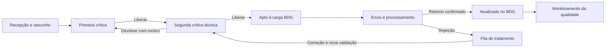

# Propostas de telas e menus para evolução do SADGEO

Base: documentos de requisitos, estágios, casos de uso, wireframe AS-IS e quebra de telas enviados nesta conversa. As telas e menus de baixo impacto foram gerados na 0.2, conforme solicitação posterior do usuário. Os itens **propostos** descrevem as operações definitivas ainda pendentes: ter uma tela não significa executar o fluxo. Consulte [o escopo da entrega](RELEASE-0.2.md). A [rastreabilidade](RASTREABILIDADE.md) identifica as fontes e divergências. O [TODO](../TODO.md) organiza os incrementos.

## O que a 0.2 realmente oferece

| Área | Estado atual |
|---|---|
| Painel de Controle | Indicadores, gráficos e tabelas; ainda sem personalização completa por unidade/perfil |
| Login e sessão | Demo funcional; AD/LDAPS configurável por ENVVAR, sem validação institucional neste ambiente |
| Crítica de Dados e sete análises | Template de **consulta** compartilhado, busca, projeto, paginação no servidor e detalhes; sem salvar/liberar/reter registros de estação |
| Campanha e tabelas básicas | CRUD genérico, incluindo Localização e Pendências; testes demo/JDBC isolado, Oracle real pendente |
| Importação, imagens, rascunho, modelos, homologação, acompanhamento e filas | Telas geradas; prévias locais quando aplicáveis, sem comandos de produção |
| Produção / Exportações | Consulta analítica com filtros e CSV; formatos TXT/KMZ/CoordDalti pendentes |
| Integrações e Ajuda | Estado de configuração/health e guia de uso disponíveis |
| Detalhe da estação | Abas de consulta geradas; dados inexistentes no contrato aparecem como indisponíveis, sem simular coordenadas/fotos/histórico |
| NUE, Códigos de Estação e Tipo de Ocorrências | Templates; faltam definições das tabelas e campos |
| Testes | Testes Java/React e scripts externos curl/PowerShell; não comprovam homologação no Oracle/AD/BDG reais |

CRUD de Campanha não equivale a um módulo de planejamento de áreas, recursos e equipes. CRUD da tabela de pendências não equivale à gestão de pendências de uma estação. Exclusão de código básico não equivale ao UC14 de excluir registro geodésico.

## Cobertura dos cinco estágios

| Estágio | Delimitação | Tela/menu pertinente | Incremento |
|---|---|---|---|
| 1. Planejamento e execução de campo | O processo físico continua fora do SADGEO | Manter Campanha como referência cadastral; eventualmente vincular projeto, equipe/NUE e documentos de planejamento existentes | Base 0.2; complementos após confirmar integrações |
| 2. Preparação e inserção | Entrada efetiva no sistema | Recepção de Lotes, Novo Registro, Fotos e Documentos; integrações SIDGEO/SIGCVEG | M02–M03 |
| 3. Crítica e validação | Fluxo operacional central | Caixa de Trabalho da 1ª crítica, mesma área técnica por tema para 2ª crítica, Devoluções e Acompanhamento | M04–M05 |
| 4. Atualização e disponibilização | Integrar e conferir, sem substituir os sistemas de publicação | Fila de Carga BDG, Retornos/Rejeições, Exportações e relatórios autorizados | M05–M06 |
| 5. Monitoramento e manutenção | Qualidade dos dados e operação do produto | Ocorrências de Consistência, Execuções de Verificação, Auditoria, Ajuda/Manuais | M07–M08 |

Não há proposta de construir um coletor móvel/offline ou um ERP de planejamento de campo. Publicação externa continua dependente da política e dos canais institucionais do BDG, sem criar automaticamente um portal público no SADGEO.

## Menu futuro recomendado

**Hoje** = funcionalidade atual, ainda sujeita à validação institucional; **consulta** = lê dados, sem executar o fluxo; **template** = somente estrutura; **proposto** = operação no backlog; sua área visual já pode existir na 0.2.

```text
Painel de Controle                                      [hoje; ampliar por perfil]
Planejamento
  Campanha                                              [hoje: cadastro]
  Estações previstas / equipe / NUE                     [proposto, só se houver integração pertinente]
Levantamento de Campo
  Recepção de Lotes                                     [template 0.2; processamento pendente]
    Importar SIDGEO                                     [template]
    Receber SIGCVEG                                     [template 0.2]
  Novo Registro / Arquivo                               [prévia local 0.2; gravação pendente]
  Carregar Imagens                                      [template]
  Crítica de Dados — 1ª instância                        [consulta; ações propostas]
  Acompanhamento                                        [template 0.2; escopo operacional pendente]
Análise
  Altimetria (medA)                                     [consulta]
  Gravimetria (medG)                                    [consulta]
  Planimetria (medP)                                    [consulta]
  VRF (vrf)                                            [consulta]
  VEG (veg)                                            [consulta]
  OGR (ogr)                                            [consulta]
  Ajustes de Gabinete (gab)                             [consulta]
Homologação
  Cadastro da Solicitação                               [template; fluxo próprio a especificar]
  Registro de Processamento                             [template]
  Realizar Homologação                                  [template]
Integração BDG                                          [templates 0.2; integração pendente]
  Aguardando carga
  Em processamento
  Retornos e rejeições
  Reconciliação SADGEO × BDG
Qualidade e Produção                                    [templates 0.2 + consulta/CSV de produção]
  Pendências e devoluções operacionais
  Ocorrências de consistência
  Verificações programadas
  Análise de produção / relatórios
Administração
  Perfil de Acesso                                     [template]
  Usuário                                              [template; vínculo institucional]
  Permissionamento                                     [template]
  Auditoria                                            [template 0.2]
  Integrações — estado                                  [consulta 0.2; sem exibir segredos]
Tabelas básicas                                        [cadastros de códigos, não operações do fluxo]
  Localização; Pendências; Tipo de Projeto; Situação do Marco
  Método de Cálculo; Fonte de Coordenada; Equipamento; Atividade
  Status; Município                                    [hoje]
  NUE; Códigos de Estação; Tipo de Ocorrências           [templates; definições pendentes]
Ajuda e Manuais                                        [guia 0.2]
```

A árvore reúne o menu gerado na 0.2 e a evolução operacional. As telas de integração, edição e qualidade estão identificadas como templates; seus comandos de produção dependem dos milestones. A navegação operacional deve exibir apenas itens permitidos ao usuário. Ocultar um item não substitui a autorização na API.

Mapa, fotos, documentos, comparar coordenadas, exportar, clonar e histórico devem ser ações do registro selecionado, acessíveis pela área de trabalho. Evitar um menu global separado para cada aba ou botão do ASP. A fila de carga é distinta da edição de registros e da homologação.

## Template principal: área de trabalho do registro

Usar a mesma composição em Crítica de Dados e nas sete análises. O contexto muda a campanha implícita, as permissões e as ações de estágio; não deve gerar sete cópias do formulário.

```text
[breadcrumb / etapa]                       [campanha fixa] [modo Acompanhamento]
[UF] [Município] [Projeto] [Unidade] [Situação] [Pendência] [Aplicar] [Limpar]
[quantidade filtrada] [filtros ativos]                       [Exportar seleção]
┌─────────────────────────────┬────────────────────────────────────────────┐
│ Lista paginada de registros  │ Estação / registro / unidade / etapa       │
│ Código • município • status │ Dados | Coordenadas | Fotos | Documentos  │
│ Pendências • datas • crítico│ Pendências | Histórico                    │
│ seleção simples ou em lote  │ conteúdo da aba + validações contextuais  │
└─────────────────────────────┴────────────────────────────────────────────┘
[Voltar] [Salvar rascunho] [Solicitar complemento] [Reter / Devolver] [Liberar]
[Usuário/perfil no menu inferior]       [rodapé do ambiente e versão atual]
```

No desktop, lista e detalhe lado a lado ou detalhe em drawer; no celular, detalhe em tela cheia, sem sete colunas comprimidas. Abrir detalhes deve preservar filtros, seleção, página e posição de rolagem. Avisar antes de abandonar alterações não salvas. A API deve retornar ações permitidas para o registro; botões desabilitados devem explicar o motivo.

O exemplo é o alvo de composição do editor: a 0.2 implementa abas de consulta e prévias, mas não a edição persistente nem os comandos do fluxo. O formulário atual de consulta a fatos não deve ser reutilizado como se já fosse uma API de gravação de `T_SADGEO`.

### T01 — Painel de Controle e caixa de trabalho

Ampliar o painel existente com cartões por instância, devoluções e tempo em fila; clicar num cartão abre a lista com filtros cumulativos. Separar produção da unidade, pendências do próprio usuário e indicadores gerais autorizados. Exibir data da última atualização; não apresentar o cubo carregado na inicialização como se fosse atualizado em tempo real. Fontes: ReqF04/05/09, UC11/19.

### T02 — Novo registro e edição descritiva

Abas Dados Gerais, Localização, Coordenadas, Fotos, Documentos, Pendências e Histórico. Buscar estação existente no BDG e indicar a origem/data dos campos sugeridos. Preservar contexto de projeto, campanha, instituição, unidade e informante/NUE, após confirmar os vínculos reais. Oferecer template descritivo por tipo de monumento, com prévia e edição consciente; não sobrescrever texto digitado silenciosamente. Fontes: ReqF01, UC02; AS-IS Inserir Registro.

### T03 — Recepção e conferência de lotes

Assistente: origem/arquivo → leitura → prévia → erros/duplicidades → confirmação → resultado. Mostrar totais aceitos/rejeitados, erro por linha e possibilidade de baixar relatório. Preservar arquivo de origem e responsável. SIDGEO e SIGCVEG precisam de contratos próprios e reenvio sem duplicar registros. Validar as regras de projeto/campanha e informante das notas legadas antes de gravar. Fontes: estágio 2, ReqF01 (SIGCVEG), AS-IS Inserir Arquivo e TODO legado (SIDGEO).

### T04 — Fotos e documentos do registro

Galeria com foto panorâmica, chapa, foto atual do BDG e, para VEG, situação da estação. Mostrar tipo, origem, data, autor e motivo de substituição; ampliar imagem sem perder seleção. Validar formato, tamanho e associação à estação. GEDLivre: listar/abrir fichas e cadernetas; gravação de documento só após confirmar API, autorização e retorno de identificador. Fontes: ReqF07/11, UC06/08/12/13; AS-IS Fotos/Documentos.

### T05 — Coordenadas e comparação com BDG

Comparação lado a lado: valor, fonte, data, datum/SRID e unidade. Apresentar diferença calculada e método utilizado; não comparar coordenadas em referenciais distintos sem transformação validada. Ações propostas: manter anterior ou solicitar atualização; salvar decisão e justificativa no histórico. Mapa segue os mesmos filtros e o registro selecionado. Confirmar provedor/licenciamento e integração BDGMapaWeb antes de escolher implementação. Fontes: ReqF08/10, UC07; AS-IS Comparar Coordenadas.

### T06 — Crítica, devolução e acompanhamento

Exibir instância atual, responsável, critérios e bloqueios. Salvar não equivale a liberar. Devolver exige motivo e destino; pedir complemento mantém o estágio conforme UC03. Acompanhamento é consulta dos registros já liberados da unidade, com destaque textual além de cor para os atualizados/criticados pela área técnica; inserir, excluir, salvar e liberar ficam indisponíveis. A mesma regra precisa ser verificada no backend. Fontes: ReqF02/04/09, UC03/16.

### T07 — Fila e retorno da carga BDG

Listar somente registros elegíveis após validação técnica. Mostrar lote, tentativa, protocolo, resultado por registro e motivos de rejeição. Repetir envio não pode duplicar carga. “Enviado” não significa “Atualizado”: somente confirmação/reconciliação marca atualização. Publicação externa não é liberada apenas por um botão local. Fontes: estágio 4, UC03/16.

### T08 — Qualidade e produção

Duas visões: ocorrências verificáveis por registro e painel gerencial por período/tema/unidade. Verificações programadas para coerência município/UF × coordenadas, imagens e completude. Registrar regra, evidência, severidade, responsável e resultado de nova verificação. Alertar sem corrigir automaticamente dados oficiais. TXT, KMZ, relatório simplificado e exportação específica Altimetria/CoordDalti respeitam os mesmos filtros/permissões. Fontes: ReqF06/12, UC05/09/19.

## Decisões antes de implementar os comandos

1. Confirmar duas instâncias de crítica versus menção a uma terceira, seus atores e transições.
2. Confirmar a separação entre cadastrador e primeiro crítico e as regras para unidade, tema, PROJ e clonagem entre temas (UC03/ReqF04).
3. Mapear rótulos de estágio para colunas e códigos Oracle reais; os nomes do diagrama abaixo são conceituais, não novos valores a gravar no banco.
4. Especificar o fluxo de Homologação e sua relação, se houver, com crítica, processamento e carga. Não presumir equivalência.
5. Confirmar contratos e direitos de escrita SIDGEO/SIGCVEG, BDG e GEDLivre e a governança de publicação externa.
6. Decidir política de exclusão de registro geodésico, preservação de histórico e dependências (UC14), sem confundir com exclusão de código básico.



Na solicitação de complemento, manter o estágio e registrar a pendência. O diagrama é uma proposta inicial de fluxo; precisa ser conciliado com os códigos e regras do legado antes de virar implementação.
