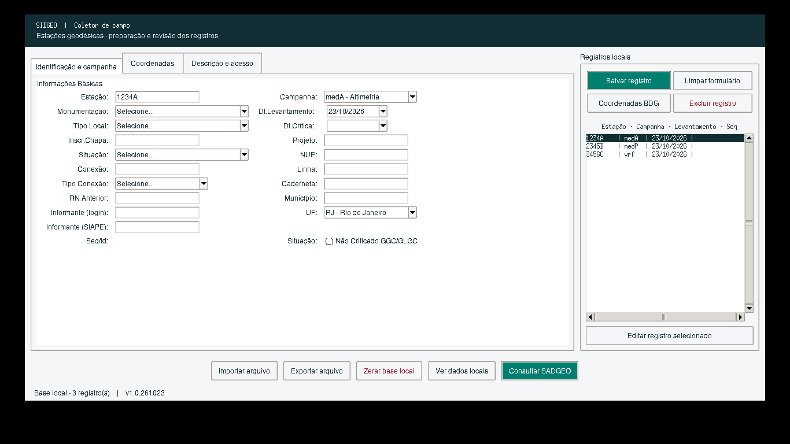

# SIDGEO — Coletor de campo

Aplicativo desktop Python/Tkinter para preparar e revisar registros de estações geodésicas. Versão **v1.1.1.261023**, independente da versão do portal `sadgeoweb`.

A tela segue a paleta e a organização do [DynAdjustWeb](https://github.com/pjagimenez/DynAdjustWeb): cabeçalho verde escuro, painéis claros, botões compactos e destaque para a ação principal. Na resolução **1366 × 768**, a janela reserva espaço para a barra de tarefas. Os campos estão em quatro abas, com rolagem quando necessário:

- **Identificação e campanha:** estação, situação, informante, projeto, campanha e datas.
- **Coordenadas:** latitude/longitude, fonte, atualização e possibilidade de ocupação.
- **Descrição e acesso:** descrição, localização, itinerário e observação, com ajuda (?) e sete modelos de descritivo.
- **Fotografias:** panorâmica, chapa e fotos adicionais, prévia e tratamento da etiqueta.

A listagem e os botões Salvar, Limpar, Coordenadas BDG e Excluir ficam visíveis à direita. Importar/exportar arquivos, consultar SADGEO, ver/zerar a base e **Empacotar ZIP** ficam na barra inferior. **Ver REG**, à direita, abre o relatório da estação no navegador. Aplicar coordenadas do BDG altera o formulário; clique em **Salvar registro** para persistir.



## Build no Windows com PowerShell

Use Python **3.11 ou superior, com Tkinter e suporte a `venv`/`pip`**; a validação nesta alteração usou Python 3.12. Uma distribuição portátil completa pode ficar em uma pasta gravável, sem instalação administrativa. O pacote *embeddable* mínimo do Python não inclui todos esses componentes.

Depois de atualizar o repositório, entre na pasta do coletor:

```powershell
cd .\sadgeo-coletor
.\build.ps1
```

Se o Python não estiver no PATH, informe o executável para criar o ambiente:

```powershell
.\build.ps1 -Python 'C:\Desenvolvimento\Python312\python.exe'
```

O script cria `.venv`, instala dependências quando os arquivos `requirements*.txt` mudam, verifica imports, Pylint, Pyright e testes automatizados, gera **`dist\sidgeo.exe`** e executa um teste de inicialização do próprio executável com uma base temporária. Qualquer falha interrompe o processo. Não é necessário ativar o `venv` nem ter permissão administrativa.

Nas execuções seguintes, a instalação é dispensada se os requisitos não mudaram. Para reinstalar as dependências ou abrir a aplicação ao terminar:

```powershell
.\build.ps1 -InstallDependencies
.\build.ps1 -Run
```

`-Python` seleciona o Python usado para **criar** `.venv`; um ambiente já criado continua sendo reutilizado. O executável Windows deve ser gerado **no Windows**. A primeira extração de um executável `onefile` pode demorar alguns segundos.

Se a política institucional bloquear scripts, use o procedimento autorizado pelo administrador. Os scripts não alteram a política de execução, o Git, certificados ou configurações globais.

## Rodar durante o desenvolvimento

Depois de preparar o ambiente com o build:

```powershell
.\.venv\Scripts\python.exe app.py
```

Para preparar apenas as dependências, sem gerar o executável:

```powershell
python -m venv .venv
.\.venv\Scripts\python.exe -m pip install -r requirements.txt -r requirements-dev.txt
.\.venv\Scripts\python.exe app.py
```

A entrada atual é **`app.py`** e o empacotamento oficial usa **`sidgeo.spec`**, compatível com PyInstaller 6. Os arquivos `build.bat` e `testebuild.bat` encaminham para os scripts PowerShell e propagam seu código de erro.

## Testar sem gerar o executável

```powershell
.\testes.ps1
# Ou selecionar outro ambiente já preparado:
.\testes.ps1 -Python 'C:\Ambientes\sidgeo\Scripts\python.exe'
# Sem uma sessão gráfica (omite explicitamente os testes de tela):
.\testes.ps1 -SkipGui
```

O teste completo exige sessão gráfica e cobre abertura e dimensionamento em 1366 × 768, abas, edição, listagem, exclusão com confirmação, importação/exportação, diálogos de arquivo, comparação BDG e encerramento. Também verifica reabertura do HDF5, zeros à esquerda e preservação da base quando uma gravação falha. Os testes usam dados sintéticos e diretórios temporários, sem acessar a base de trabalho ou as APIs institucionais.

Para executar diretamente em Linux, com Tkinter e sessão gráfica disponíveis:

```sh
python -m venv .venv
.venv/bin/python -m pip install -r requirements.txt -r requirements-dev.txt
.venv/bin/python -m pytest -q --require-gui
.venv/bin/python -m PyInstaller --noconfirm --clean sidgeo.spec
./dist/sidgeo --smoke-test
```

## Logs e dados locais

| Arquivo | Conteúdo |
|---|---|
| `logs\resultado-build.txt` | Instalação, verificações, empacotamento e resultado do build |
| `logs\resultado-testes.txt` | Execução avulsa de `testes.ps1` |
| `sidgeo.log`, no diretório de logs do usuário | Eventos e exceções da aplicação, inclusive callbacks Tkinter; rotação de até três arquivos de 500 KB |
| `sidgeo.h5`, no diretório de dados do usuário | Base de trabalho local |

Os caminhos da aplicação são definidos por `platformdirs`. Para ver os caminhos exatos no seu computador:

```powershell
.\.venv\Scripts\python.exe -c "import platformdirs; print('Dados:', platformdirs.user_data_dir('SIDGEO', appauthor=False, roaming=False)); print('Logs:', platformdirs.user_log_dir('SIDGEO', appauthor=False))"
```

A base é salva após cada alteração e não fica dentro do executável. Faça backup antes de substituir uma versão em uso. Falhas de leitura preservam o arquivo original e são reportadas; falhas de escrita preservam o último arquivo salvo. **Zerar base local** exige confirmação. CSV usa `;` como separador; JSON usa uma lista de registros. A chave lógica continua sendo `cod_estacao`: importar a mesma estação atualiza seu registro. Uma importação com registros inválidos informa quantos foram processados e mantém os válidos já gravados.

## Integrações e certificados

As URLs-base BDG/SADGEO estão em `sidgeo/util/settings.py`:

```python
APP_URL_SADGEO = "https://w3.api-sadgeo.ibge.gov.br/api"
APP_URL_BDG = "http://w3.servicoscged.ibge.gov.br/api/v1/bdg"
```

Configure somente a base nesse arquivo. O cliente acrescenta a rota e o código da estação. Para `3677J`, as requisições são:

```text
SADGEO GET https://w3.api-sadgeo.ibge.gov.br/api/itemsadgeo/filtrar/estacao/3677J
BDG GET http://w3.servicoscged.ibge.gov.br/api/v1/bdg/estacoes?codigoEstacao=3677J
```

A correção **v1.1.1** troca a rota incorreta `/estacao/<codigo>` do BDG por `/estacoes` com o parâmetro `codigoEstacao`. A URL do SADGEO foi preservada. O campo `dataMedicaoCoordenada` do BDG alimenta a data da coordenada, independentemente da data da visita ou do cálculo. Os formatos GMS com grau `º`, espaços e segundos com vírgula do retorno de `3677J` foram verificados. O cliente BDG aceita coleção de estações, página com `content` ou objeto de estação e seleciona o código solicitado; retorno vazio significa ausência de dados. Respostas ambíguas ou malformadas são reportadas. HTTP 404 é reportado como erro de rota/requisição, não como consulta vazia.

O `sidgeo.log` registra a URL solicitada, URL final após redirecionamentos e status HTTP. Falhas de certificado TLS, timeout, conexão/DNS/proxy e leitura de JSON têm diagnóstico específico e detalhes da exceção no log. Os corpos das respostas e as senhas não são registrados. No Windows, o caminho padrão é `%LOCALAPPDATA%\SIDGEO\Logs\sidgeo.log`; confirme o caminho efetivo com o comando da seção anterior.

Após alterar configurações ou atualizar os clientes, reinicie o kernel do Spyder. Para o `.exe`, gere novamente com `build.ps1`. O navegador e o Python podem usar cadeias de confiança diferentes; o funcionamento no navegador não comprova a confiança do certificado pelo Python.

As rotas foram verificadas em testes HTTP locais, sem enviar dados às APIs institucionais. O acesso externo desta sessão às URLs institucionais foi bloqueado pelo proxy HTTP, portanto a consulta real deve ser validada na rede da instituição.

Se houver uma autoridade certificadora interna, configure o certificado PEM aprovado para cada ferramenta, sem desativar a validação HTTPS:

```powershell
# Downloads de pacotes pelo pip, quando necessário:
$env:PIP_CERT = 'C:\Certificados\cadeia-institucional.pem'
# Consultas HTTPS da aplicação via requests, quando necessário:
$env:REQUESTS_CA_BUNDLE = 'C:\Certificados\cadeia-institucional.pem'
```

Se os downloads e as consultas funcionam normalmente, essas variáveis não precisam ser definidas.

## Organização

`view` contém os widgets e diálogos; `application` coordena os casos de uso; `domain` contém registro, validação e mapeamento; `infra` implementa persistência, arquivos, logs e clientes HTTP. `tests` contém os testes de regressão; `typings/tkcalendar` descreve a API utilizada dessa biblioteca para a análise estrita do Pyright. As pastas `old`, `extras` e `imagem` contêm material legado ou experimental e não compõem a aplicação empacotada.

## Validação desta alteração

Foram executados **83 testes**, incluindo a interface em display virtual de 1366 × 768 e com fontes ampliadas, além da análise estrita do Pyright (zero erros/avisos), Pylint nas categorias de erro e verificação de imports. `testes.ps1` foi executado com PowerShell 7.4; a sintaxe dos scripts, argumentos com espaços e interrupção por código de erro também foram verificados.

O empacotamento PyInstaller 6 e o teste `--smoke-test` foram validados em Linux/Python 3.12. A geração e a execução do **`.exe` Windows** devem ser validadas no Windows com `build.ps1`; esta sessão não dispõe desse sistema operacional. Os scripts usam comandos compatíveis com Windows PowerShell 5.1.

## Informante e comparação de coordenadas (v1.1)

**Informante** recebe o login de rede (ex.: `nome.sobrenome`, `nome_sobrenome`, `login123`), sem espaços, domínio `DOMINIO\` ou e-mail. A validação de formato ocorre na interface e no serviço, inclusive na importação; ela não consulta o LDAP. O texto inválido é mantido para correção. O novo campo **Unidade informante** oferece as unidades SES e CGED indicadas pela área usuária. Bases antigas continuam abrindo com esse campo vazio.

**Coordenadas BDG** compara os dados atuais do formulário com o retorno do BDG, aceita hemisférios `S/W/O/N/E` e sinais `+/-`, reconhece graus e aspas Unicode e segundos com vírgula. Dados não reconhecidos geram erro; não são transformados silenciosamente em zeros. A janela mostra a data da coordenada quando fornecida pelo serviço e a diferença horizontal **aproximada**, em metros (Haversine; sem componente de altitude).

**Usar BDG** aplica coordenadas e fonte, marca **Atualizar** e preserva as possibilidades de ocupação locais. **Manter Local** marca **Manter**. Ambas as escolhas precisam de **Salvar registro** para persistir. O botão **Ver REG** abre `https://bdg.ibge.gov.br/bdg/pdf/relatorio.asp?L1=<codigo>` no navegador padrão.

A ajuda **(?)** junto ao descritivo apresenta os sete modelos fornecidos (chapa, pino, tronco de pirâmide, pilares cilíndricos e prismáticos). É possível copiar ou acrescentar um modelo ao texto existente; substitua os marcadores `#` pelas informações de campo.

## Fotos e pasta do usuário

Os dados e as fotos ficam na pasta **SIDGEO** dentro do perfil do usuário. No Windows:

```text
%LOCALAPPDATA%\SIDGEO\
├── sidgeo.h5
├── imagens\
│   ├── <sha256>.jpg
│   └── <sha256>.png
└── Logs\
    └── sidgeo.log
```

A localização efetiva é obtida por `platformdirs`, respeitando as pastas do Windows. Não é preciso criar pastas em `Program Files` nem ter privilégios administrativos. Para backup manual completo, copie a pasta SIDGEO inteira.

Na aba **Fotografias**, adicione panorâmica, chapa e fotos adicionais **JPEG ou PNG**, com até **5 MB (5.242.880 bytes) por arquivo**. A prévia usa uma miniatura; o original é copiado para o perfil e não é alterado. A aba mostra as quantidades e avisa quando faltam panorâmica/chapa; rascunhos e registros antigos continuam podendo ser salvos sem fotos.

Os nomes físicos usam SHA-256 para evitar colisões e duplicação de conteúdo; tipo, nome original, tamanho e hash ficam vinculados ao registro no HDF5. Clique em **Salvar registro** após incluir, tratar ou remover vínculos. Remover um vínculo não apaga o arquivo original do disco. Imagens sem vínculo são conservadas localmente; o ZIP inclui as imagens dos registros salvos e os originais necessários para reeditar suas etiquetas.

### Redimensionar e ajustar a etiqueta

1. Informe o código da estação e adicione/selecione uma foto.
2. Clique em **Redimensionar foto / Ajustar etiqueta**.
3. Escolha o tipo da estação, por exemplo `SAT` ou `RN`, e confira o código.
4. O limite inicial é **640 × 480 pixels**, preservando a proporção e sem ampliar fotos menores. Largura e altura máximas são ajustáveis; desmarque Redimensionar para manter a resolução.
5. Ajuste **Horizontal (X)**, **Vertical (Y)**, **Comprimento** e **Altura da etiqueta**, em pixels da foto final. A etiqueta inicial usa 370/280/70/15, ajustada à área disponível na primeira abertura. Posições fora da imagem são recusadas.
6. Atualize a prévia. **Aplicar ao registro** cria uma cópia JPEG tratada; depois, salve o registro. **Salvar cópia...** permite gravar um JPEG em uma pasta escolhida sem alterar o vínculo atual.

O original e os ajustes são preservados. Ao reeditar, a imagem é recriada a partir do original, permitindo mover a etiqueta sem acumular etiquetas antigas. A cópia final também respeita o limite de 5 MB.

### Empacotar ZIP com a base completa

Clique em **Empacotar ZIP** e escolha onde salvar. O pacote contém **todos os registros salvos da base local**, sem filtros:

```text
pacote.zip
├── sidgeo.h5
├── registros.csv
├── registros.json
└── imagens\
    ├── <fotos vinculadas>
    └── <originais das fotos tratadas>
```

Alterações ainda não salvas do formulário não entram no pacote. O HDF5 é uma cópia independente da base; JSON e CSV incluem as referências e metadados, sem Base64. Use o ZIP para transportar dados **e** imagens. CSV/JSON avulsos transportam somente dados e referências, portanto não bastam para levar as fotos a outro perfil.

Em outro computador, use **Importar arquivo → zip**. O importador usa `registros.json`, confere tamanho e SHA-256 das imagens e copia os arquivos para a pasta SIDGEO do usuário de destino. Estações existentes são atualizadas pela chave `cod_estacao`; os demais registros do destino são preservados. O JSON de dados do ZIP tem limite de 50 MB; o limite individual de foto é 5 MB. Caminhos arbitrários do ZIP nunca são extraídos.

O pacote contém dados de campo e fotos, não um ambiente Python nem o código-fonte. Para obter o projeto de software completo, use o Git ou **Code → Download ZIP** no GitHub. A sincronização com o SADGEO/BDG real e o envio de imagens ao servidor dependem dos contratos da API institucional.

Telas da versão 1.1: [fotografias](docs/sidgeo-fotografias.png), [tratamento da etiqueta](docs/sidgeo-etiqueta.png) e [comparação BDG](docs/sidgeo-comparacao-bdg.png). As fotos das capturas são sintéticas.
